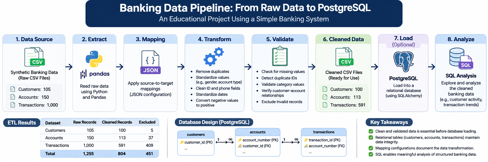

# Understanding the Data Pipeline: From Raw Data to PostgreSQL

### A Hands-On Learning Project Using a Simple Banking System

This project explores how raw data is extracted, cleaned, transformed, validated, and prepared for storage in a PostgreSQL relational database.

Using a fictional banking system, the project demonstrates the fundamentals of **ETL (Extract, Transform, Load)** through Python, Pandas, JSON mapping configurations, and SQL.

The main objective is to understand how data moves from its original, inconsistent form into structured datasets that can support analysis and decision-making.

> **Disclaimer:** This is an educational project using synthetically generated banking data. It is not connected to a real banking system and does not contain real customer records.

---

## 1. Project Objectives

- Understand the end-to-end ETL process.
- Generate and explore synthetic banking datasets.
- Identify common data-quality problems.
- Clean and standardize data using Python and Pandas.
- Validate relationships between customer, account, and transaction records.
- Understand how relational tables are structured in PostgreSQL.
- Explore banking data through SQL analytical queries.

## 2. Technologies Used

| Technology | Purpose |
|---|---|
| Python | Data generation and ETL processing |
| Pandas | Data cleaning, transformation, and validation |
| JSON | Source-to-target column mapping |
| PostgreSQL | Relational database target |
| SQLAlchemy | Database connectivity and data loading |
| SQL | Database schema and analytical queries |
| Jupyter Notebook | Interactive ETL development |

## 3. Data Pipeline Architecture



The project follows this workflow:

```text
Synthetic Banking Data
          |
          v
    Raw CSV Files
          |
          v
   Extract with Pandas
          |
          v
   JSON Mapping Rules
          |
          v
 Cleaning & Transformation
          |
          v
 Data Quality Validation
          |
          v
    Cleaned CSV Files
          |
          v
 PostgreSQL Database
   (Optional Loading)
          |
          v
   SQL Data Analysis
```

The cleaning and validation stages can be executed without installing PostgreSQL. Database loading is optional and requires a configured PostgreSQL environment.

## 4. Project Datasets

The project uses three synthetic datasets.

| Dataset | Description | Raw Records |
|---|---|---:|
| Customer Master | Fictional customer information | 105 |
| Account Master | Bank accounts linked to customers | 150 |
| Transaction History | Deposits, withdrawals, and transfers | 1,000 |
| **Total** | | **1,255** |

The data generator deliberately introduces inconsistencies to simulate common data-quality issues found in legacy systems.

Examples include duplicate records, inconsistent date formats, missing values, invalid transaction types, negative balances, and records referencing nonexistent customers or accounts.

All identification and phone values in the new dataset use fictional placeholders.

## 5. ETL Process

### Extract

Python and Pandas read the raw CSV files. JSON mapping files describe the relationship between source columns and target database fields.

### Transform

The notebook applies transformations such as:

- Removing duplicate customer records.
- Standardizing gender, account type, account status, and transaction type values.
- Cleaning fictional identification and phone fields.
- Standardizing dates and transaction timestamps.
- Converting negative balances and transaction amounts to absolute values.
- Renaming source columns to match the target schema.

### Validate

Validation checks include:

- Missing required values.
- Duplicate identifiers.
- Invalid account and transaction categories.
- Accounts referencing nonexistent customers.
- Transactions referencing accounts excluded during cleaning.

Records that fail the implemented validation rules are excluded from the cleaned output.

### Load

Cleaned data can be exported into CSV files for inspection or loaded into PostgreSQL through SQLAlchemy.

The notebook contains a configuration switch:

`LOAD_TO_POSTGRES = False`

When disabled, the pipeline performs cleaning and validation without connecting to PostgreSQL.

## 6. ETL Results

The following results were obtained from running the Python ETL notebook with PostgreSQL loading disabled.

| Dataset | Raw Records | Cleaned Records | Excluded |
|---|---:|---:|---:|
| Customers | 105 | 100 | 5 |
| Accounts | 150 | 113 | 37 |
| Transactions | 1,000 | 591 | 409 |
| **Total** | **1,255** | **804** | **451** |

The results illustrate how data cleaning, validation, and relational checks reduce the number of records available for downstream processing.

**Note:** These figures are from the current synthetic dataset and ETL execution. Generating different source data or modifying validation rules may produce different results.

## 7. Database Design

The PostgreSQL schema consists of three relational tables:

**Customers**

Stores customer IDs, names, fictional identifiers, contact placeholders, birth dates, gender, and creation dates.

**Accounts**

Stores account numbers, customer references, account types, balances, statuses, and opening dates.

**Transactions**

Stores transaction IDs, account references, transaction types, amounts, and transaction timestamps.

The relationships are:

`customers (1) → (many) accounts`

`accounts (1) → (many) transactions`

Primary and foreign keys are used to describe and enforce relational integrity when the schema is created in PostgreSQL.

## 8. SQL Analysis

The project includes SQL queries for exploring:

1. Overall banking data summary.
2. Top 10 customers by recorded transaction volume.
3. Transaction type distribution.
4. Accounts without recorded transactions.
5. Accounts with recorded transactions.
6. Monthly transaction trends.
7. Account status distribution.

These queries demonstrate how structured banking data can support analytical reporting.

Transaction volume is calculated from positive transaction amounts and should not be interpreted as net cash flow.

## 9. Project Structure

```text
learning-banking-data-pipeline/
│
├── data/
│   ├── customer_master.csv
│   ├── account_master.csv
│   └── transaction_history.csv
│
├── mappings/
│   ├── customer_mapping.json
│   ├── account_mapping.json
│   └── transaction_mapping.json
│
├── notebooks/
│   └── etl_pipeline.ipynb
│
├── sql/
│   ├── banking_schema.sql
│   └── banking_analysis.sql
│
├── output/
│   ├── customers_clean.csv
│   ├── accounts_clean.csv
│   └── transactions_clean.csv
│
├── images/
│
├── generate_sample_data.py
└── README.md
```

## 10. How to Explore the Project

1. Install the required Python packages: `pandas`, `sqlalchemy`, and `ipykernel`.
2. Run `generate_sample_data.py` to generate the synthetic CSV datasets.
3. Open `notebooks/etl_pipeline.ipynb` in a Jupyter-compatible environment.
4. Keep `LOAD_TO_POSTGRES = False` to run the pipeline without PostgreSQL.
5. Execute the notebook cells in order.
6. Review the cleaned DataFrames and exported CSV files in `output/`.

For optional PostgreSQL loading, prepare a database, create the tables using `sql/banking_schema.sql`, and configure the database connection through environment variables.

Database loading has not been retested as part of the new public project preparation.

## 11. Key Learning Outcomes

Through this project, I explored how raw datasets are prepared for structured storage and analysis.

The main lessons include:

- Data cleaning is essential before database loading.
- Consistent formatting improves data usability.
- Primary and foreign keys are important for maintaining relationships.
- Data validation helps prevent invalid records from reaching downstream systems.
- Mapping configurations document how source data corresponds to target tables.
- SQL provides a way to explore cleaned, structured datasets.

## 12. Future Improvements

Potential extensions include:

- More detailed data-quality and rejection reports.
- Automated ETL testing.
- Improved database loading and duplicate handling.
- Logging and exception management.
- Connecting PostgreSQL to Power BI for interactive reporting.

---

**Project Type:** Personal Learning Project  
**Domain:** Synthetic Banking Data  
**Focus:** Data Engineering Fundamentals, ETL, Data Quality, Relational Databases

*From raw data to structured information — learning how data moves, changes, and becomes useful.*